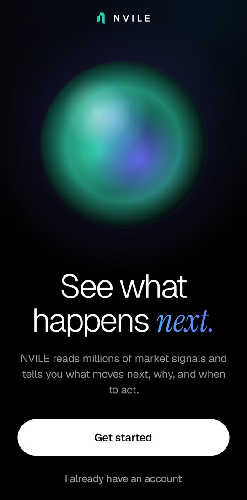
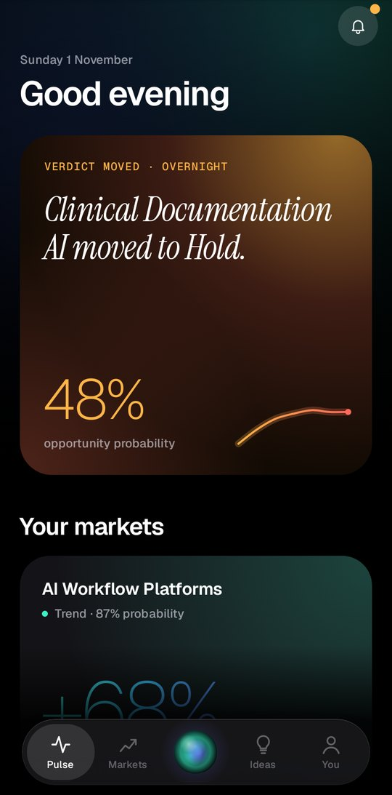
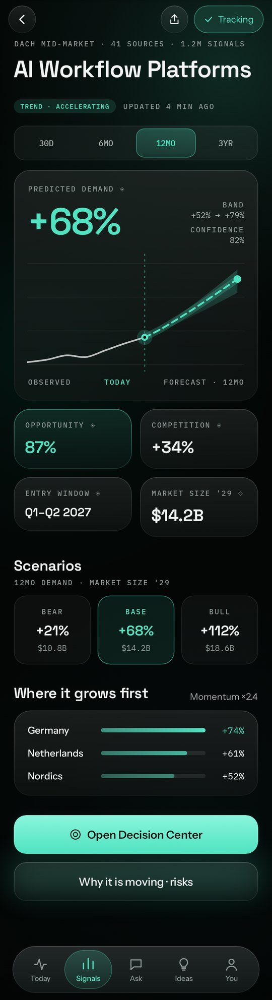
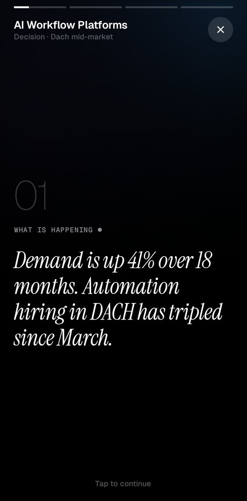
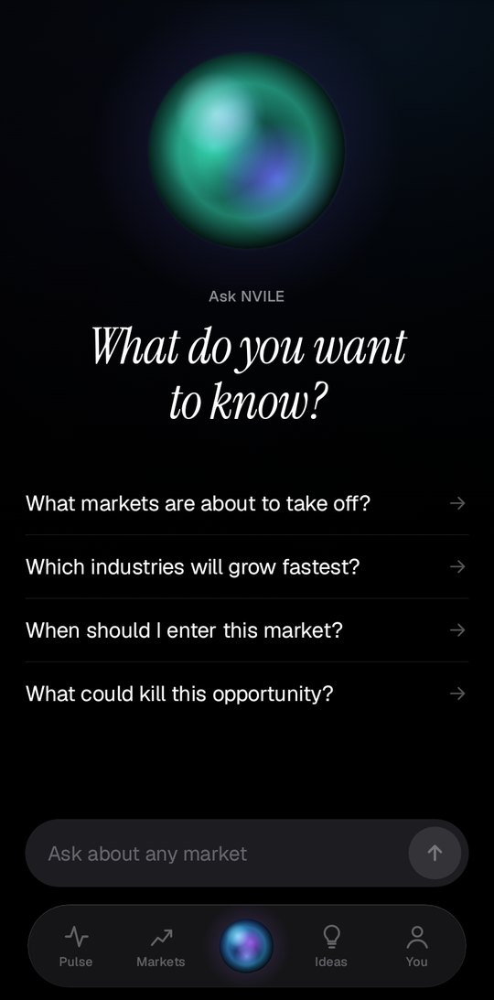
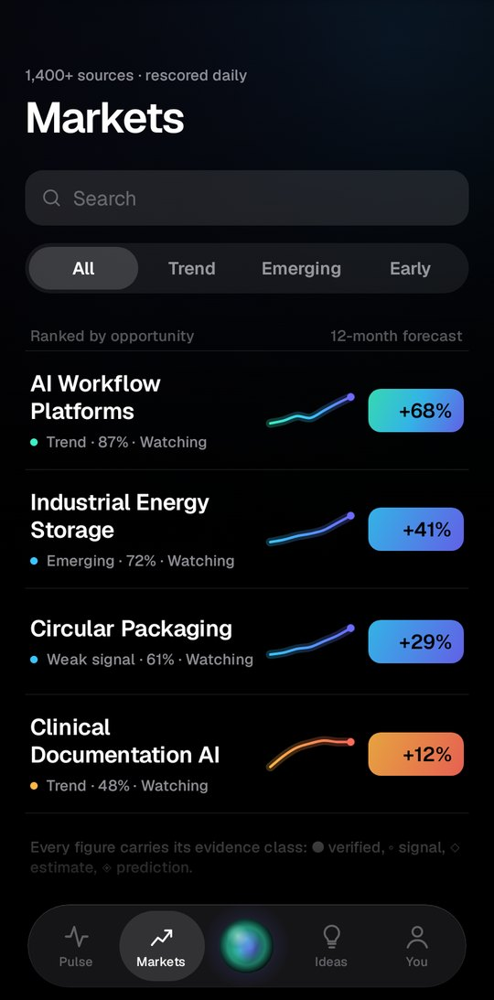
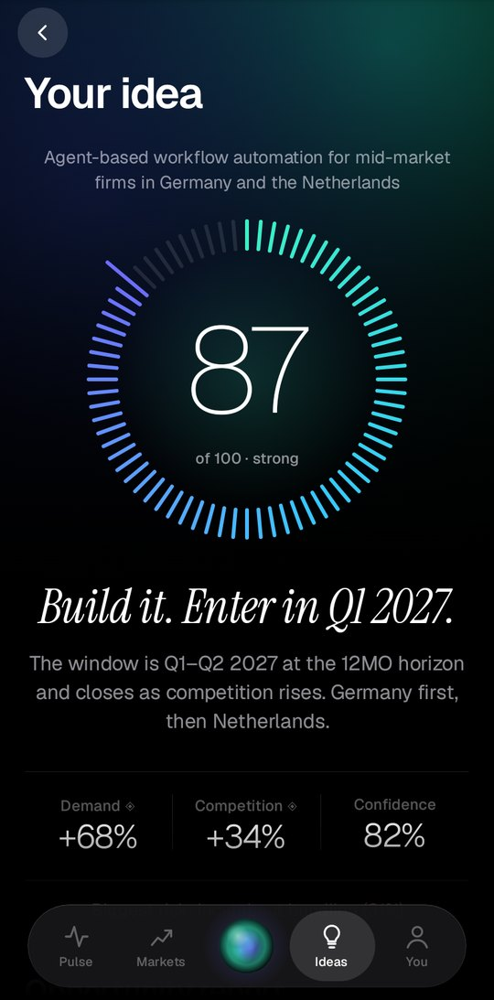
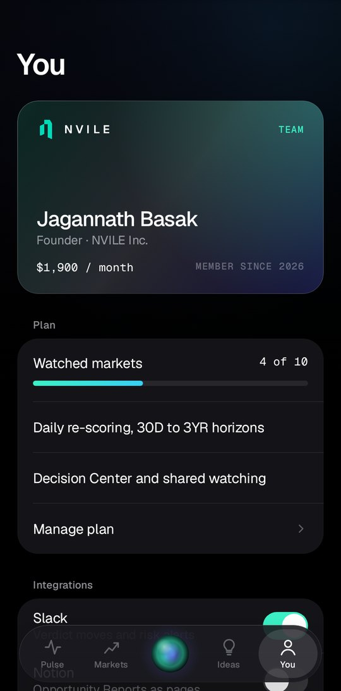

# NVILE for Android

Native Android app for NVILE: detect signals, see why markets move, forecast the outcome, and
know when to act. Every figure carries its evidence class: ● Verified, ◦ Signal, ◇ Estimate,
◈ Prediction.

Built with Kotlin and Jetpack Compose. Screens follow the **NVILE Mobile App** design canvas.

## Experience

| Tab | What it does |
| --- | --- |
| Welcome | A living orb, an editorial headline, one clear action |
| Onboarding | Pick what you decide, tap a floating constellation of markets, watch the orb tune your brief |
| Pulse | Cinematic "verdict moved" card, a swipeable carousel of your markets, the signal of the day |
| Markets | Stocks-style ranked list with spectrum value pills |
| Market | Giant numeral that follows your finger as you scrub a full-bleed forecast with a probability fog; the call, scenarios, drivers, risks |
| Decision | Four full-screen chapters, told like a story: what is happening, why, what next, what to do |
| Ask (orb) | A conversation: the orb rises and swirls while it thinks, then answers with a serif verdict |
| Ideas | Write an idea in big type, get a watch-style score dial and an 8-part report |
| You | Tilting membership card, plan, integrations, Apple-style grouped settings |

## Screenshots

Rendered on the JVM by `ScreenshotTest` (Robolectric + Roborazzi). Refresh them by running the
**Update screenshots** workflow.

| Welcome | Pulse | Market (scrub the forecast) | Decision story |
| --- | --- | --- | --- |
|  |  |  |  |
| **Ask** | **Markets** | **Idea score** | **You** |
|  |  |  |  |

## Design system: "Observatory"

- **Ground:** true black, with slow-drifting pools of light whose colour follows the market's mood.
- **The Orb:** NVILE's signature. A fluid-noise AGSL shader on Android 13+ (layered-gradient fallback below).
- **Type:** Geist for the interface with hairline giant numerals, Instrument Serif italic for verdicts,
  Geist Mono for data. All bundled under the SIL Open Font License (`licenses/`).
- **Colour:** the prediction spectrum (mint, cyan, indigo) for momentum; the caution spectrum
  (amber, coral) for calls under pressure.
- **Motion and touch:** spring physics, haptic ticks while scrubbing and switching, staggered reveals,
  self-drawing charts, counting numerals.

Tokens live in `app/src/main/java/com/nvile/app/ui/theme`, components in `ui/components`.

## Data

`data/SeedRepository.kt` serves a demo dataset behind the `NvileRepository` interface. AI
Workflow Platforms carries the full report from the design; the other markets are
illustrative. The engines API (`Nvile/trends-intelligence`) is internal (NestJS → Python with a
service key), so the app will reach it through a public gateway. Implement
`NvileRepository` against that gateway to go live; the UI needs no changes.

## Build

Requirements: JDK 17 and the Android SDK (API 35).

```bash
./gradlew assembleDebug        # app/build/outputs/apk/debug/app-debug.apk
./gradlew installDebug         # onto a connected device or emulator
```

CI (`.github/workflows/android.yml`) builds debug and release APKs and runs lint on every
push; download the APKs from the run's **nvile-apks** artifact. The release build is signed
with the debug key for review only — add a real upload key before publishing to Google Play.
